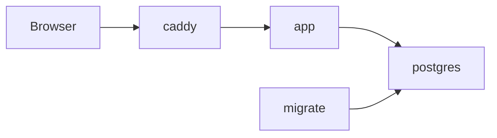

# Architecture

## Containers

`docker compose up` runs these services.

| Service | Image | Role |
| --- | --- | --- |
| `caddy` | `caddy:2-alpine` | The only service with published ports. Reverse proxy to `app`. Gets HTTPS certificates when `SITE_ADDRESS` is a domain name. |
| `app` | built from `Dockerfile` (target `app`) | The Next.js server, from the standalone build. Runs as the unprivileged `node` user. |
| `migrate` | built from `Dockerfile` (target `migrate`) | One-shot job. Applies the committed SQL migrations in `drizzle/`, then exits. |
| `postgres` | `postgres:17-alpine` | The database. Data lives in the `pgdata` volume. |

Use a URL-safe `POSTGRES_PASSWORD` (letters and digits), because it is placed inside the connection URL.

The `worker` service (SMS jobs with pg-boss) joins in the SMS phase.

## Start order

1. `postgres` starts and passes its health check.
2. `migrate` runs and must exit with success.
3. `app` starts.
4. `caddy` starts and proxies to `app`.

If a migration fails, `app` never starts.

## Network and ports

- Only `caddy` publishes ports: `HTTP_PORT` (default 8080) and `HTTPS_PORT` (default 8443).
- `postgres` publishes nothing. `app` and `migrate` reach it as `postgres:5432` on the Compose network.
- For development, `compose.dev.yaml` adds a Postgres port bound to `127.0.0.1` so pnpm, drizzle-kit and the tests can connect. `pnpm db:up` uses it. Never use it on a server.

## Sign-in and access

- `src/proxy.ts` sends a request without a session cookie to `/login`. It never checks that the cookie is valid.
- `requireOwner()` in `src/lib/auth/server.ts` is the real check. It reads the session from the database and redirects to `/login` without one. Every page, layout, server action and route handler calls it first.
- `/api/auth/[...all]` is the Better Auth route (ADR 0002). Only `/sign-in/email` and `/sign-out` answer; every other auth path answers 404, sign-up and the admin plugin included. The list lives in `EXPOSED_AUTH_PATHS` in `src/lib/auth/auth.ts`.
- `pnpm owner:create` creates the one owner account through the admin plugin, server-side.
- Each sign-in attempt and each sign-out writes an `audit_log` row with no email and no IP address.

## Configuration

All variables are listed in `.env.example`. Secrets stay in `.env`, which git ignores.

## Images

The `Dockerfile` has one stage per job: `deps`, `build`, `migrate` and `app`. The `app` image holds only the Next.js standalone output. The `migrate` image holds production dependencies, the `drizzle/` folder and `scripts/migrate.mjs`.
